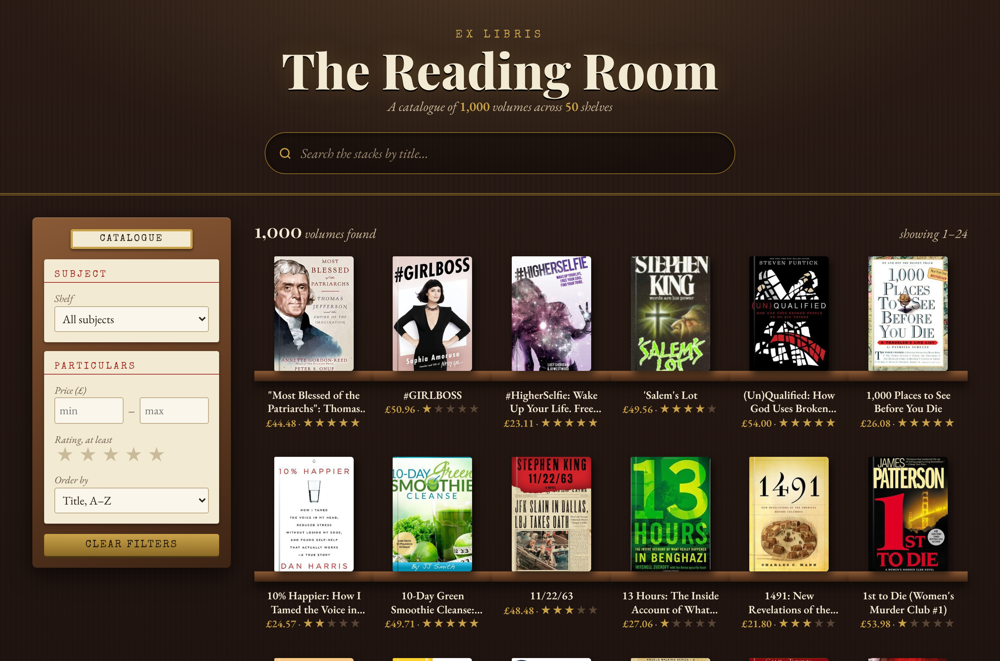
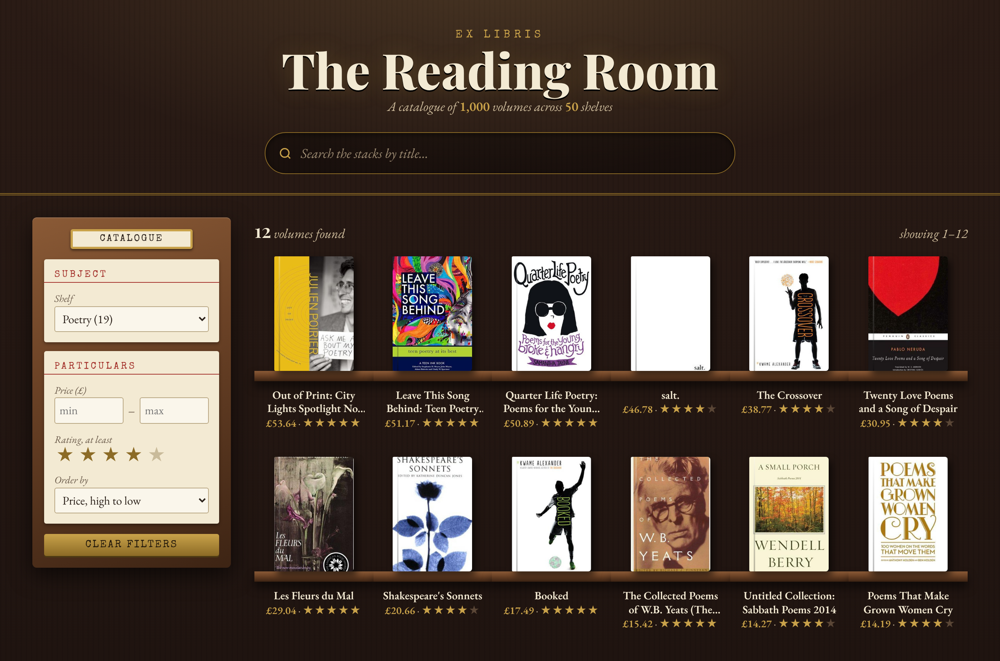
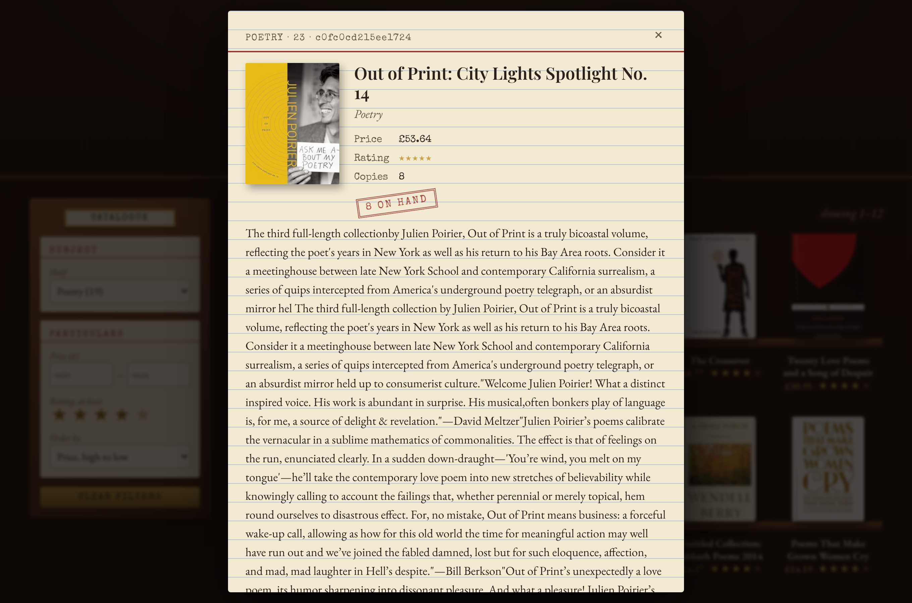

# Books to Scrape → database → library app

> **Project 2 of 3** in our *Programming with AI* submission.
> [1 · Momentum Dash replica](https://github.com/jacopolorenzetti05-cmd/momentum-chrome-extension) ·
> **2 · Books to Scrape (this repo)** ·
> [3 · TVmaze API](https://github.com/jacopolorenzetti05-cmd/couch-control)

| | |
|---|---|
| **Status** | ✅ Complete: scraper, database, web app, 24 automated tests |
| **Try it in 3 commands** | `pip install -r requirements.txt` → `python scrape.py --limit 200` → `python app/server.py --sqlite books.db` |
| **Live demo** | https://book-scraper-library.onrender.com (free hosting, see [note](#limitations-and-assistance)) |
| **Audit** | [AUDIT.md](AUDIT.md) |



---

## Purpose

A Python scraper that collects every book on [books.toscrape.com](https://books.toscrape.com)
(a sandbox site built for scraping practice), stores it in a **relational database**, and a
small **web app** to search and browse what was collected.

- **Scraper** – crawls the 50 listing pages and 1,000 book pages, validates every record and writes it to the database.
- **Database** – four linked tables, with a price/stock history per scrape run.
- **Library app** – search by title; filter by subject, price range and minimum rating; sort; open a book's catalogue card with its price history.

## Data collection

| | |
|---|---|
| **Source** | `https://books.toscrape.com` only. `scraper/fetch.py` refuses any other host. |
| **Method** | HTTP GET with `requests`, HTML parsed with `BeautifulSoup` + `lxml`. |
| **Flow** | listing pages → book URLs → detail pages (8 parallel workers) → `parse` → `validate` → store. |
| **Politeness** | Minimum 0.1 s between requests, retries with back-off, a clear User-Agent. A full run takes about 2 minutes. |
| **Fields** | title, UPC, category, price (GBP), stock, star rating, description, cover image URL, page URL. |

The parser (`scraper/parse.py`) is pure: it only turns HTML into objects, so it is tested on saved
pages in `tests/fixtures/` with no network needed. Author is not collected because the site doesn't
publish it. Tax, review count and product type are dropped because they're the same on every book
(reasoning in [docs/DESIGN.md](docs/DESIGN.md)).

## Data persistence

```
categories 1 ──< books 1 ──< book_snapshots >── 1 scrape_runs
   slug          upc            (run_id, upc)          id
```

| Table | Stores | Why |
|---|---|---|
| `categories` | slug, name | Normalised: a book points at one category. |
| `books` | one row per book, keyed by the site's UPC | Upserts make re-runs safe: no duplicates. |
| `scrape_runs` | start/end time, status, pages, errors | An audit trail of every crawl. |
| `book_snapshots` | price and stock per book **per run** | Builds a price/stock history over time. |

**Two interchangeable back-ends**, same schema, same code path (`scraper/store.py`):

- **SQLite** (`books.db`, the default): zero setup, ideal for trying the project or grading it.
- **Supabase (Postgres)**: the shared cloud database behind the live app. Schema in `db/schema.sql`,
  tables locked with Row Level Security.

## User interaction

1. **Scrape** from the terminal: `python scrape.py` (options: `--limit`, `--max-pages`, `--sink`).
2. **Browse** in the browser at `http://localhost:8000`:
   - type in the search box to match titles,
   - pick a subject, a price range and a minimum star rating,
   - sort by title, price, rating or copies on hand,
   - click a book to open its card: description, stock and the price/stock **ledger** across scrape runs.
3. Filters are kept in the URL, so a filtered view can be bookmarked or shared.

| Filtered: Poetry, 4★+, price high→low | Book card with description and ledger |
|---|---|
|  |  |

*Screenshots: local run on the SQLite database after a full scrape (1,000 books, 50 categories, 0 errors).*

## Setup

**Needs:** Python 3.10+ and internet access to books.toscrape.com. Dependencies: `requests`,
`beautifulsoup4`, `lxml` (in `requirements.txt`). Nothing else.

### A. Run it locally – no account or keys needed (recommended for grading)

```bash
git clone https://github.com/jacopolorenzetti05-cmd/Book-Scraper
cd Book-Scraper
python -m venv .venv && source .venv/bin/activate     # Windows: .venv\Scripts\activate
pip install -r requirements.txt

python -m unittest discover tests        # 24 offline tests, < 1 s
python scrape.py --limit 200             # ~25 s; omit --limit for all 1,000 books (~2 min)
python app/server.py --sqlite books.db   # open http://localhost:8000
```

Expected end of the scrape log: `scrape run 1 success: 50 pages, 1000 books, 0 errors`.
Run every command from the repository root. Use `--port 8080` if port 8000 is busy.

### B. Run it on Supabase (the shared cloud database)

1. Create a Supabase project, open the **SQL editor** and run `db/schema.sql`.
2. `cp .env.example .env` and fill in `SUPABASE_URL` and `SUPABASE_SERVICE_ROLE_KEY`
   (Project Settings → API). `.env` is git-ignored: **never commit it**.
3. Check the connection, then scrape and serve:

```bash
python scripts/supabase_smoke_test.py
python scrape.py --sink supabase --limit 40     # small first
python scrape.py --sink supabase
python app/server.py                            # reads Supabase live
```

### C. Hosting and automation (already configured)

- **Render**: `render.yaml` is a Blueprint for the library app. The two Supabase values are entered
  in Render's dashboard and are not stored in git.
- **GitHub Actions**: `.github/workflows/scrape.yml` runs the tests and then a full scrape into Supabase,
  started by hand from *Actions → Scrape into Supabase → Run workflow*. It reads the keys from repository secrets.

### Project layout

| Path | Role |
|---|---|
| `scrape.py` | CLI entry point |
| `scraper/fetch.py` | HTTP session, retries, throttle, locked to books.toscrape.com |
| `scraper/parse.py` | HTML → `Book` / `Category` (pure functions, tested on saved pages) |
| `scraper/models.py` | Dataclasses + `validate()` |
| `scraper/pipeline.py` | crawl → parse → validate → store; records the `scrape_runs` row |
| `scraper/store.py` | `SqliteSink` and `SupabaseSink` (same interface, upserts) |
| `scraper/supabase_client.py` | Minimal Supabase REST client (no SDK needed) |
| `app/server.py` | Read-only JSON API + serves the page; Supabase **or** SQLite |
| `app/static/index.html` | The library UI (vanilla HTML/CSS/JS) |
| `db/schema.sql` | Postgres tables, keys, constraints, RLS |
| `scripts/` | Supabase setup helper and connection smoke test |
| `tests/` | Parser, validation, query-building and SQLite-app tests |

## Learning

- **What we learned.** Separating *fetch*, *parse*, *validate* and *store* made every part testable
  on its own. The parser is tested on saved HTML, so the tests run offline in under a second.
  Upserting on natural keys (UPC, category slug) makes a scraper safe to re-run.
- **Challenge 1: designing the schema.** Our first schema copied every field on the page. While
  normalising it we saw that tax, review count and product type are constant, so we dropped them. We also
  split *what a book is* (`books`) from *what it cost on a given day* (`book_snapshots`). That split is
  what makes the price history possible.
- **Challenge 2: keeping the database key secret.** Supabase tables are locked with Row Level Security,
  so the browser can't read them directly. Our answer was a small server that holds the
  `service_role` key and exposes only a **read-only** API with whitelisted sort columns, validated
  numbers and regex-checked IDs. User text can never change the shape of a query.
- **Challenge 3: the free tier sleeps.** The live app stopped working when Supabase paused the free
  project. We made the server return a clear "database unreachable" message, and during the
  handover we added the **SQLite mode** so the app runs for anyone without our credentials.

## Limitations and assistance

**Limitations**

- **Live demo availability.** The Render app and its Supabase database run on free plans. The app
  sleeps after 15 minutes (first load takes about a minute), and Supabase pauses the database after 7
  idle days, so the live link may answer "database unreachable". This is expected free-tier
  behaviour. The logic and design are all in this repository, and **Option A above always works**.
- Some descriptions on books.toscrape.com repeat part of their own text. That is the source data;
  we store it as published.
- No author field (the site has none). Prices are a single GBP value.
- The Supabase path writes with the `service_role` key. A production version would use the `anon`
  key plus insert/update RLS policies.
- The library app is read-only by design: no accounts, no editing.

**Assistance**

- **AI:** Claude Code (Anthropic) wrote most of the code under our direction. Commits authored
  `Claude` in the history are AI-generated. We set the requirements, reviewed the output,
  ran it, and asked for changes. Claude Code also ran the publication audit in [AUDIT.md](AUDIT.md),
  added the SQLite mode, the security headers and their tests, and wrote this README.
- **Docs used:** Requests, Beautiful Soup, Supabase/PostgREST REST API, Render Blueprint docs.
- **External code:** none copied. Data comes from books.toscrape.com, a public practice site.

---

*History: started inside our Chrome-extension repo and moved here with its full commit history.
An earlier SQLite-only CLI is kept on the `v1-sqlite` branch.*
